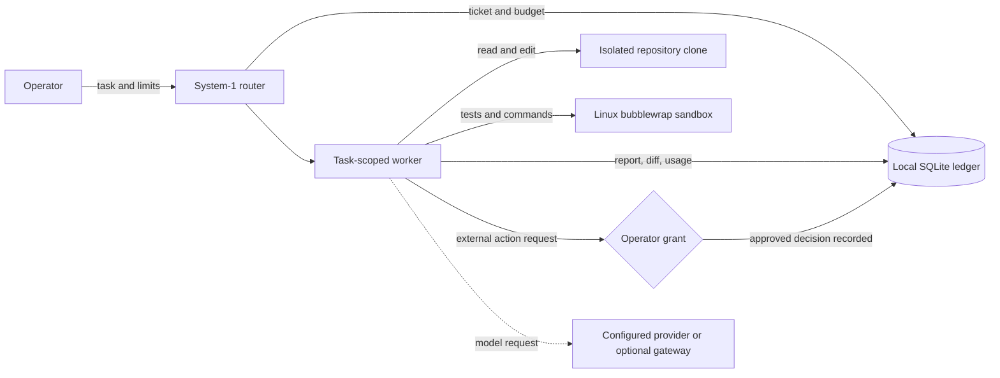

# 👻 gh0st

<p align="center">
  <strong>Local-first task execution for AI-assisted development—work in an isolated clone, verify the result, and keep external actions under operator control.</strong>
</p>

<p align="center">
  <a href="https://github.com/Judge-M/gh0st/actions/workflows/linux-release-gates.yml"></a>
  <a href="LICENSE"></a>
  <a href="https://www.python.org/downloads/"></a>
  <a href="https://github.com/Judge-M/gh0st"></a>
</p>

<p align="center">
  <a href="#-what-gh0st-does">What it does</a> ·
  <a href="#-the-execution-boundary">Execution boundary</a> ·
  <a href="#-quick-start">Quick start</a> ·
  <a href="#-browser-dashboard">Dashboard</a> ·
  <a href="#-python-sdk">Python SDK</a> ·
  <a href="#-self-hosted-mobile-relay">Mobile relay</a> ·
  <a href="#-development">Development</a>
</p>

---

## ✨ What gh0st does

gh0st is a Python SDK and CLI for running bounded, task-scoped development work. Each repository task gets its own clone at a recorded source commit. A worker can edit files, run tests, inspect failures, and report a diff; requests that reach outside the local workspace stay behind explicit operator grants.

| 🧰 Work locally | 🧭 Route deliberately | 🧪 Verify the result | 🔐 Gate external actions |
| :--- | :--- | :--- | :--- |
| Task-scoped repository clones with a recorded source commit. | Smart, cost, quality, speed, or local policies, with an optional fixed-model override. | Iterative edit and test loop with commands, results, diff, and unresolved failures in the report. | Remote pushes, production writes, and non-gateway network actions become ledger grant requests. |

### At a glance

- **Python SDK and CLI:** use gh0st from scripts and services, or run it from a terminal.
- **SQLite state ledger:** tickets, reports, quota reservations, and grant decisions are recorded locally.
- **Provider flexibility:** direct in-process provider adapters are the default; an OpenAI-compatible gateway is optional.
- **Local control surfaces:** loopback API, browser dashboard, VS Code extension, Tauri desktop app, and a mobile pairing client.
- **Self-hosted relay:** run locally or deploy the broker yourself with Docker Compose. A managed hosted relay is a possible paid-tier feature for later; it is not available today.

## 🛡️ The execution boundary



On Linux, the local command sandbox uses bubblewrap: the task clone is the persistent writable mount, `/tmp` is temporary, runtime directories are read-only, and the command has no network namespace access. The model request itself runs in-process through the configured provider adapter; choosing a model provider is a separate network and credential decision from the local command sandbox.

Workers do not write to the source checkout. A grant records an operator decision; it does not itself perform the external action.

## 🚀 Quick start

### Requirements

- Linux, Python 3.12+, Git, and `bubblewrap` (`bwrap`) on `PATH` for local command execution.
- A supported provider package and model credentials. Pricing and model capacity must be configured; unknown pricing is blocked unless explicit rates are supplied.

Install the core and OpenAI provider adapter:

```bash
python -m pip install "gh0st-core[openai]"
```

Configure a model and provider key:

```bash
export OPENAI_API_KEY=your-provider-key
export GH0ST_DEFAULT_MODEL=openai:gpt-4o-mini
export GH0ST_DEFAULT_MODEL_CONTEXT=128000
export GH0ST_DEFAULT_MODEL_PAYLOAD=100000
export GH0ST_DEFAULT_MODEL_QUALITY=frontier
```

Run a bounded task against a repository:

```bash
gh0st run "Fix the failing parser test" \
  --source-repo /path/to/repo \
  --budget 3.50 \
  --tokens 50000
```

Other provider extras include `anthropic`, `google`, and `ollama`. Model IDs use `provider:model`, such as `anthropic:claude-3-5-sonnet` or `openrouter:deepseek/deepseek-r1`. Provider credentials can be resolved from environment variables, files, HashiCorp Vault, or 1Password Connect. See the configuration details below before using a non-default provider.

## 🌐 Browser dashboard

Start the loopback API and open the local dashboard:

```bash
gh0st api --host 127.0.0.1 --port 8383
```

Visit [http://127.0.0.1:8383/ui](http://127.0.0.1:8383/ui). The dashboard can submit tasks, choose a routing policy or configured model override, inspect task status and reports, review diffs and test results, and record grant decisions. If `GH0ST_API_TOKEN` is set, enter the bearer token in the dashboard; it remains in the current tab's memory.

The default interface is a locally served static export built with Next.js and the checked-in shadcn preset. To develop it:

```bash
cd interfaces/web/gh0st-web
npm ci
npm run dev
```

To rebuild the static dashboard bundled with the Python package, run `npm run build:local` in that directory.

## 🧠 Routing and model setup

System-1 supports `smart`, `cost`, `quality`, `speed`, and `local` routing policies. Placement considers requested capability and modality, domain, quality floor, context and payload capacity, latency, and configured price. A `--model` override chooses a fixed catalog target ahead of the policy, while still checking modality and context fit.

For multiple targets, set `GH0ST_MODEL_CATALOG` to a JSON array or a path to one. Each target describes its `name`, `gateway_model`, `modalities`, `context_window`, `max_payload_tokens`, `quality` (`basic` or `frontier`), and optional `domains`, `cost_rank`, and `placement`. Image targets also need `image_generation_cost_usd`. Catalog quality and capacity are operator-maintained values; gh0st does not independently benchmark model quality.

Attach local PNG, JPEG, or WebP files with repeatable `--image` flags, `image_paths` in the SDK, or the API's `image_paths` field. gh0st copies inputs into a task-scoped input directory outside the editable clone. Image generation is disabled by default; explicitly request image modality and configure its cost before dispatch.

Set `--gateway-url` to use an OpenAI-compatible gateway. Direct calls through aisuite are the default. Install the matching provider extra, for example:

```bash
python -m pip install "gh0st-core[anthropic]"
```

## 🐍 Python SDK

```python
from gh0st import Gh0stClient

client = Gh0stClient(
    db_url="sqlite:///workspace.db",
    workspace_root="./gh0st-workspaces",
)

job = client.dispatch(
    "Refactor the auth middleware and run its tests",
    source_repo="/path/to/auth-service",
    budget_usd=5.00,
    budget_tokens=100_000,
    routing_strategy="smart",
)

if job.ticket is not None:
    report = client.execute_turn(job.ticket.ticket_id)
    print(report.status, report.diff, report.test_results)
```

`dispatch` creates the task-scoped clone and ticket. `execute_turn` runs the bounded worker and returns its report. Advanced integrations can use `EphemeralWorker`, `StateLedger`, `System1Router`, and the secret resolver interfaces directly from `gh0st`.

## 📱 Self-hosted mobile relay

The relay is optional. You can run it locally or self-host it on a VPS; gh0st does not currently provide managed relay hosting. The daemon initiates an outbound connection to a WebSocket broker. Mobile pairing uses an end-to-end secret shared through a one-time `gh0st://pair?...` URI or QR code.

For local or VPS deployment with TLS and Docker Compose, follow [the relay deployment guide](docs/relay-deployment.md). The service operator remains responsible for hosting, TLS, and device credentials.

For a basic device setup, create a private `devices.json` file mapping a device ID to a long random token, then configure the relay:

```bash
export GH0ST_RELAY_URL=wss://relay.example.com
export GH0ST_RELAY_TOKEN=<same-token-as-devices.json>
export GH0ST_DEVICE_ID=my-linux
export GH0ST_RELAY_SOURCE_REPO=/path/to/approved/repo
gh0st-relay --device-id my-linux
```

In another terminal, issue a one-time pairing URI (add `--qr-output /tmp/gh0st-pair.svg` to write a QR code):

```bash
gh0st pair --relay-url "$GH0ST_RELAY_URL" --device-id my-linux
```

The relay keeps live routing state in memory; the daemon republishes active pair IDs after reconnecting. The daemon stores pairing keys under `~/.gh0st` by default; protect and back up the state database and relay key. Remote dispatch uses only `GH0ST_RELAY_SOURCE_REPO` as its source repository and caps requests with `GH0ST_RELAY_MAX_BUDGET_USD` and `GH0ST_RELAY_MAX_TOKENS`. Grant decisions are ledger records and do not run external actions.

## 🧾 Memory and retrieved references

Human-approved governance claims in SQLite are injected as **System Instructions / Constraints**. External retrieval is kept separate: results are labeled as unverified reference material and passed only to the current ticket, without copying them into the ledger.

Optional adapters are available for Mem0, Pinecone, and Qdrant:

```bash
python -m pip install "gh0st-core[mem0]"
# Or: gh0st-core[pinecone] / gh0st-core[qdrant]
```

Select one using `GH0ST_REFERENCE_PROVIDER=mem0|pinecone|qdrant`. Configure its credentials and index or collection as described in the adapter settings. `GH0ST_REFERENCE_LIMIT` caps results at 20 and `GH0ST_REFERENCE_MAX_CHARS` bounds the transient text included in a ticket.

## 🖥️ More control surfaces

- **CLI:** run, inspect, resume, and record grant decisions from a terminal.
- **Loopback API:** submit tasks and inspect reports over a local HTTP API. See [the OpenAPI contract](docs/openapi.yaml).
- **VS Code:** view recent tasks and grants, run a task from the active workspace, and save the local API token in SecretStorage.
- **Tauri desktop:** inspect tasks and reports, dispatch repository tasks, and record grants against the local daemon.
- **Mobile pairing client:** connect to a self-hosted relay and submit bounded requests or record grant decisions.

Example commands:

```bash
gh0st status <task-id>
gh0st resume <task-id>
gh0st grant <grant-id> --approve --operator "Operator name"
gh0st pairings
gh0st unpair <pair-id>
```

`gh0st grant` records a decision in the ledger. It does not execute a remote push, production write, or other external action.

## 💸 Budgets and recovery

gh0st reserves ticket allocations before dispatch and clamps each model call to the remaining token allocation and selected model context window. Completed usage, ticket status, and reservation release are recorded together. Missing or invalid usage fails the ticket; a provider or gateway `402` or `429` halts it. Configure hard key-level USD ceilings at the provider or gateway, because gh0st records usage after a completed call and cannot prevent costs already incurred.

If a worker exits without a report, its usage cannot be verified. Recovery moves the allocation from `reserved` to `uncertain` and excludes it from future admission. Recovery does not automatically replay the worker. Reconcile provider billing outside gh0st before treating that allocation as available again.

## 🧑‍💻 Development

Install the project and test dependencies, then run the Python suite:

```bash
python -m pip install -e . pytest
python -m pytest -q
```

Additional checks for the interfaces:

```bash
python -m benchmarks.admission
python -m benchmarks.routing
cd interfaces/mobile && pnpm install && pnpm typecheck && pnpm test:crypto
cd interfaces/vscode && node test/extension.test.js
cd interfaces/tauri && pnpm test
```

Linux integration tests require `bwrap`. They cover edit–test–report execution, out-of-workspace write rejection, blocked non-gateway network access, and source checkout protection. Other tests cover model placement, quota reservation, duplicate claims, ledger reporting, grants, and the API. The Linux release workflow runs the test suite, latency benchmarks, and an SDK wheel build.

The [mobile release checklist](docs/mobile-release.md) tracks physical iOS/Android reconnect and revocation validation and store packaging. Signed desktop and mobile package distribution also remains release work.

## ❓ FAQ

<details>
  <summary><strong>Does a grant run the requested external action?</strong></summary>
  <p>No. A grant records the operator's decision in the ledger. The action itself remains a separate step.</p>
</details>

<details>
  <summary><strong>Is gh0st's relay a hosted service?</strong></summary>
  <p>Not currently. V1 relay hosting is local or self-hosted. A managed paid option is future work.</p>
</details>

<details>
  <summary><strong>Can I use a fixed model?</strong></summary>
  <p>Yes. Use the CLI <code>--model</code> override or the SDK's model option. Modality and context capacity are still checked.</p>
</details>

## 📄 License

gh0st is distributed under the [Apache License 2.0](LICENSE).

---

<p align="center"><strong>Build locally. Verify the work. Keep the boundary clear.</strong></p>
