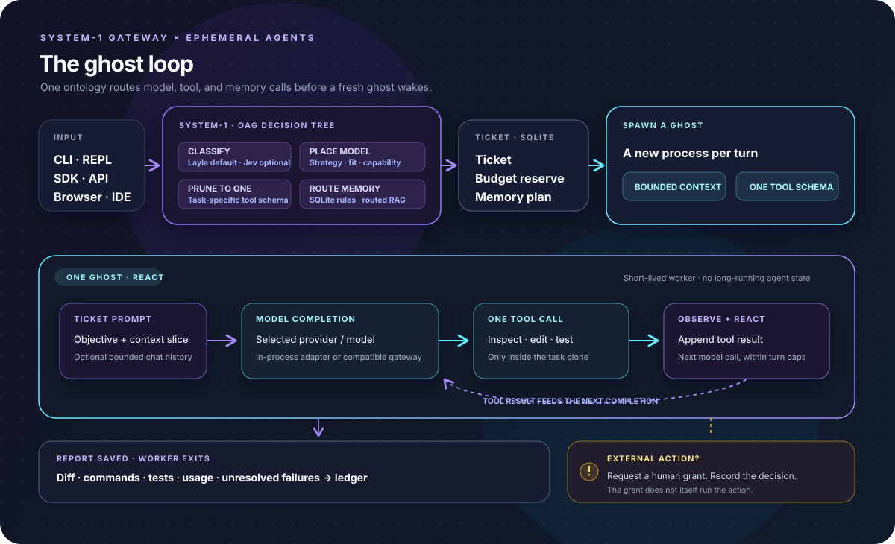

<p align="center">
  
</p>

<p align="center">
  <a href="https://github.com/Judge-M/gh0st/actions/workflows/linux-release-gates.yml"></a>
  <a href="LICENSE"></a>
  <a href="https://www.python.org/downloads/"></a>
  <a href="https://github.com/Judge-M/gh0st"></a>
</p>

<p align="center">
  <strong>An AI gateway built around ephemeral agents.</strong><br>
  System-1 routes every turn. A fresh ghost does the work, reports back, and exits.
</p>

<p align="center">
  <a href="#-try-it">Try it</a> ·
  <a href="#-the-ghost-loop">The ghost loop</a> ·
  <a href="#-choose-your-interface">Interfaces</a> ·
  <a href="#-for-developers">Developers</a> ·
  <a href="#-security-model">Security</a>
</p>

---

## 👻 Meet gh0st

**gh0st is an SDK and AI gateway for ephemeral agents.** System-1 classifies each turn, chooses a model and one relevant tool schema, and dispatches a ticket to a short-lived worker: a ghost. The ghost acts, checks its work, returns a report, and exits. A new worker and model conversation are built for the next ticket, so hidden agent state does not accumulate between turns. The REPL can pass a bounded slice of recent chat history when continuity helps.

<table>
  <tr>
    <td width="50%"><strong>🧠 System-1 gateway</strong><br>Fast local classification, model placement, budget admission, and one-schema tool pruning.</td>
    <td width="50%"><strong>👻 Ephemeral ghosts</strong><br>A fresh worker per turn. No long-lived agent process accumulating stale working state.</td>
  </tr>
  <tr>
    <td><strong>⚡ Lean context</strong><br>Tickets carry bounded context and a single task-relevant tool schema to the worker.</td>
    <td><strong>🧪 Work that verifies itself</strong><br>Ghosts edit, run tests, inspect failures, and return a diff and execution report.</td>
  </tr>
</table>

## 🔁 The ghost loop

<p align="center"></p>

1. **System-1 receives a turn.** The local Layla classifier is the zero-cost default; Jev is an optional classifier adapter.
2. **The gateway makes the call plan.** It selects capability, model target, routing policy, budget, and one tool schema. A static `--model` override takes priority while still checking capability requirements.
3. **A ticket wakes a ghost.** The short-lived worker receives its bounded context and runs the model/tool cycle for that turn. Model placement accounts for modality, task domain, quality floor, context capacity, latency, and price.
4. **The ghost acts and exits.** It can work in its task-scoped clone, run tests, and inspect failures. It returns a report with its diff, commands, test results, usage, and unresolved issues, then the process ends.
5. **The ledger keeps durable state.** Tickets, budgets, reports, and grant decisions persist in SQLite. Follow-up turns get a fresh worker and a deliberate context slice; interactive sessions retain bounded recent history for continuity.

Model completions use gh0st's in-process provider adapters by default. An OpenAI-compatible gateway such as LiteLLM or OpenRouter can be configured as the model endpoint. The System-1 gateway handles task-level routing and governance either way.

## 🚀 Try it

**Needs:** Linux, Python 3.12+, Git, and `bubblewrap` (`bwrap`). Add a supported model provider and credentials.

```bash
python -m pip install "gh0st-core[openai]"

export OPENAI_API_KEY=your-provider-key
export GH0ST_DEFAULT_MODEL=openai:gpt-4o-mini
export GH0ST_DEFAULT_MODEL_CONTEXT=128000
export GH0ST_DEFAULT_MODEL_PAYLOAD=100000
export GH0ST_DEFAULT_MODEL_QUALITY=frontier

gh0st run "Fix the failing parser test" \
  --source-repo /path/to/repo \
  --budget 3.50 \
  --tokens 50000
```

The worker operates in a task clone and returns a report with its status, commands, test results, diff, and any unresolved failures.

## 🖥️ Choose your interface

| Interface | What it’s for |
| :--- | :--- |
| **Terminal** | Run tasks, inspect reports, resume work, and review grants. |
| **Browser dashboard** | Submit tasks and explore status, diffs, tests, and grants in a local web UI. |
| **Python SDK** | Embed one-turn task execution in your own Python tools and services. |
| **VS Code** | Launch work from your workspace and inspect tasks and grants in the Explorer. |
| **Desktop app** | Use the Tauri client with the local gh0st daemon. |
| **Mobile pairing** | Reach a self-hosted relay from a paired phone. |

Start the browser UI on loopback:

```bash
gh0st api --host 127.0.0.1 --port 8383
```

Then open [127.0.0.1:8383/ui](http://127.0.0.1:8383/ui). The dashboard is built with the checked-in shadcn preset and served locally by the Python package. Add `GH0ST_API_TOKEN` to require a bearer token.

<details>
  <summary><strong>Work on the dashboard</strong></summary>
  <br>

  ```bash
  cd interfaces/web/gh0st-web
  npm ci
  npm run dev
  ```

  Run `npm run build:local` to rebuild the static UI bundled in the Python package.
</details>

## 🐍 For developers

```python
from gh0st import Gh0stClient

client = Gh0stClient(
    db_url="sqlite:///workspace.db",
    workspace_root="./gh0st-workspaces",
)

job = client.dispatch(
    "Refactor the auth middleware and run its tests",
    source_repo="/path/to/auth-service",
    budget_usd=5.00,
    budget_tokens=100_000,
    routing_strategy="smart",
)

if job.ticket is not None:
    report = client.execute_turn(job.ticket.ticket_id)
    print(report.status, report.diff)
```

Install another provider with an optional extra, for example `gh0st-core[anthropic]`, `gh0st-core[google]`, or `gh0st-core[ollama]`. Direct provider calls are the default; an OpenAI-compatible gateway is optional.

<details>
  <summary><strong>Routing, models, and images</strong></summary>
  <br>

  Choose `smart`, `cost`, `quality`, `speed`, or `local`. Routing considers capability, modality, domain, quality floor, context and payload capacity, latency, and configured price. A `--model` override pins a catalog model and still checks modality and context fit.

  Configure multiple targets through `GH0ST_MODEL_CATALOG` (JSON or a path to JSON). Catalog quality and capacity are operator-provided settings; gh0st does not independently benchmark model quality. Unknown prices are blocked unless explicit rates are configured.

  Attach PNG, JPEG, or WebP inputs with repeatable `--image` flags, the SDK's `image_paths`, or the API's `image_paths`. Inputs are copied outside the editable clone. Image generation is disabled by default and needs an explicitly configured price.
</details>

<details>
  <summary><strong>Secrets and reference memory</strong></summary>
  <br>

  Provider secrets can come from environment variables, files, HashiCorp Vault, or 1Password Connect. Set `GH0ST_SECRETS_PROVIDER` to `env`, `file`, `vault`, or `onepassword` and install `gh0st-core[onepassword]` for the 1Password Connect SDK.

  Human-approved governance claims in SQLite are injected as system constraints. Retrieved Mem0, Pinecone, or Qdrant material is kept separate, labeled unverified, and passed only to the current ticket. Install the matching extra (`gh0st-core[mem0]`, `[pinecone]`, or `[qdrant]`) and configure `GH0ST_REFERENCE_PROVIDER` plus that service's connection settings.
</details>

## 🛡️ Security model

| Inside the task workspace | Outside the workspace |
| :--- | :--- |
| Read and edit task files, run local commands and tests, create local commits. | Remote pushes, production writes, and non-gateway network actions are gated as grant requests. |

On Linux, local commands run through bubblewrap. The task clone is the only persistent writable mount; `/tmp` is temporary, runtime directories are read-only, and the command has no network namespace access. Model completions use configured providers through in-process adapters by default, or an OpenAI-compatible endpoint when configured.

**Workers never write to the source checkout.** A grant records an operator's decision; it does not itself perform the external action.

Budgets are reserved before dispatch and clamp model calls to the ticket's remaining tokens and selected model context. One-schema pruning and bounded context keep each request focused and token use controlled. If a worker exits without verified usage, the allocation is marked uncertain and is not made available again automatically.

## 📱 Mobile and relay

Run the relay locally or self-host the broker on a VPS with Docker Compose and TLS. Pairing uses a one-time `gh0st://pair?...` URI or QR code; the broker routes encrypted frames. **Managed third-party hosting is a possible paid feature for later and is not available now.**

See the [relay deployment guide](docs/relay-deployment.md) for local and VPS setup, and the [mobile release checklist](docs/mobile-release.md) for physical-device and store-release gates.

## 🧪 Develop and test

```bash
python -m pip install -e . pytest
python -m pytest -q
python -m benchmarks.admission
python -m benchmarks.routing
```

The Linux integration suite exercises isolated edit–test–report execution, workspace boundaries, network restrictions, and source checkout protection. Other tests cover routing, budgets, duplicate claims, reports, grants, and the API.

## 🗺️ What’s next

- Validate mobile reconnect and revocation on physical iOS and Android devices.
- Complete signed desktop and mobile package distribution.
- Keep local and self-hosted relay available; managed hosting is future work.

## 📄 License

[Apache License 2.0](LICENSE)

<p align="center"><sub>Local work. Verifiable results. Operator-controlled boundaries.</sub></p>
